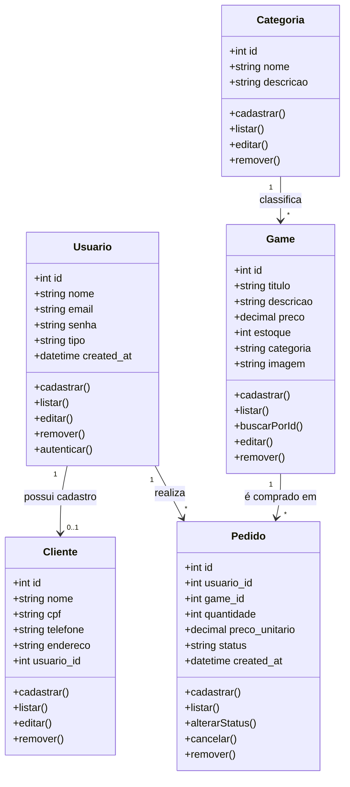
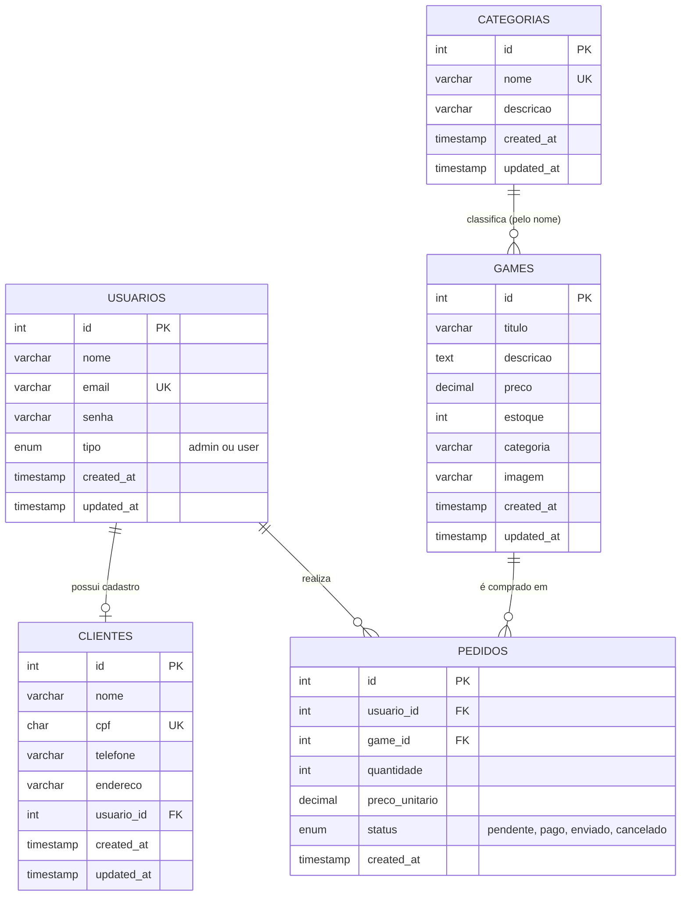
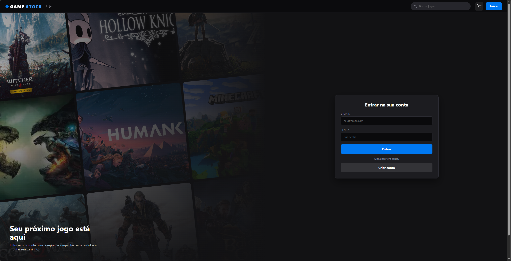
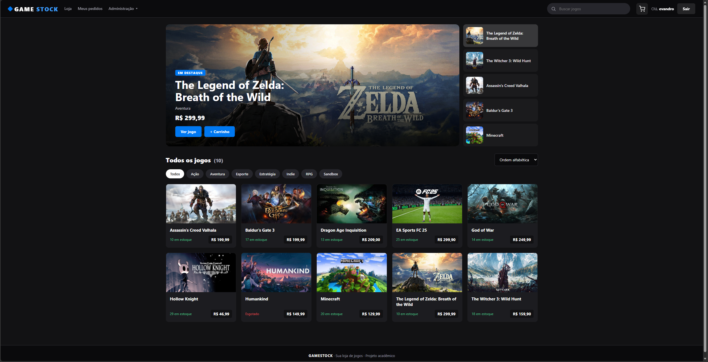
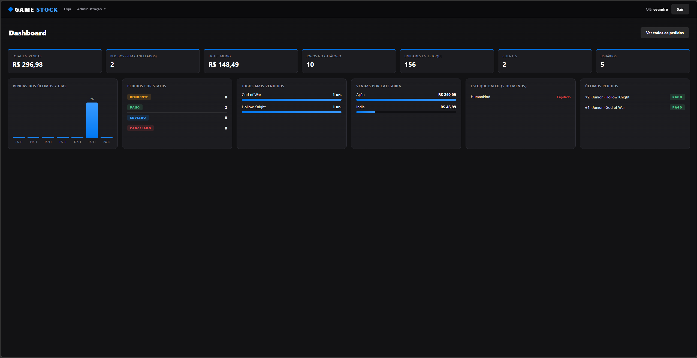
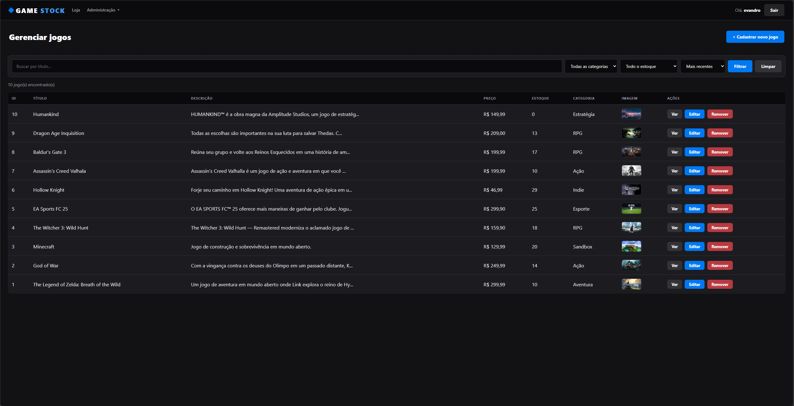
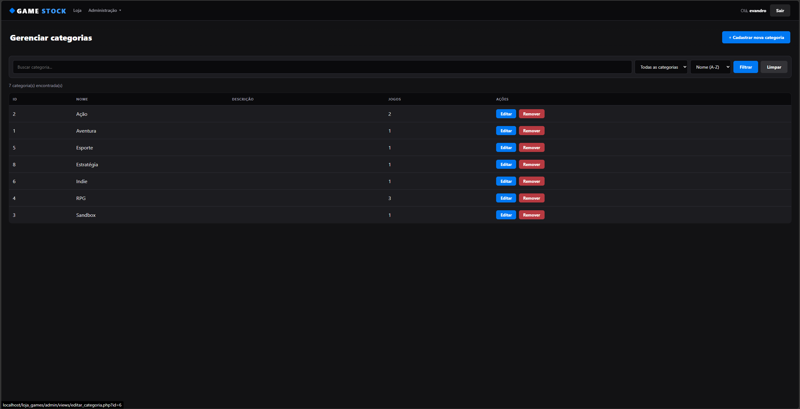
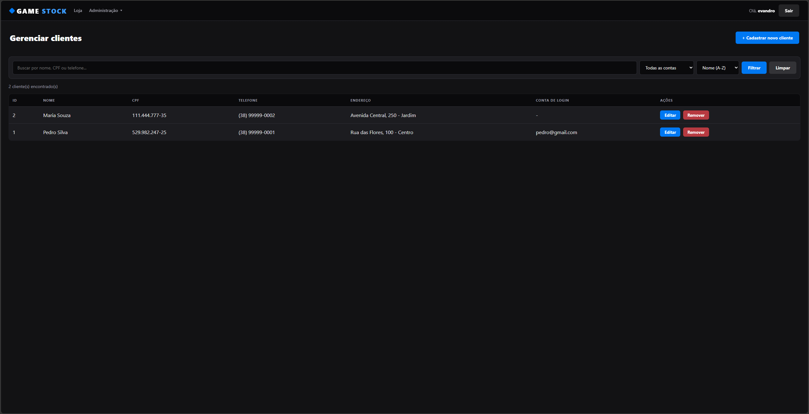
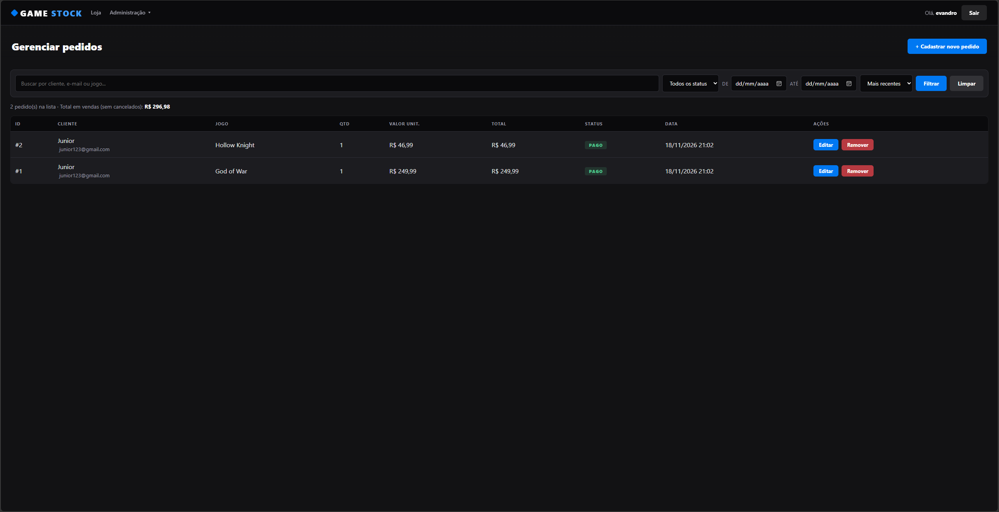
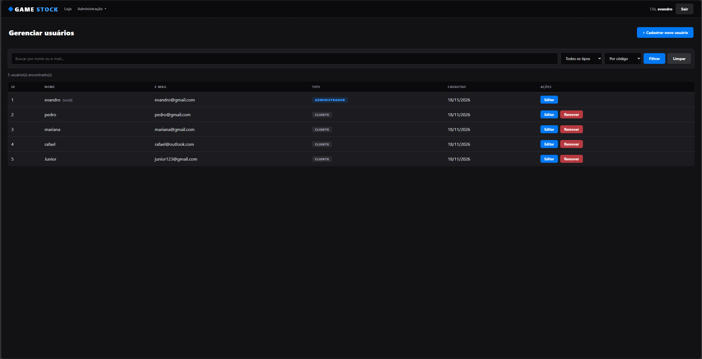

# GameStock

Sistema web de loja de jogos desenvolvido em **PHP + MySQL**, com área para clientes (vitrine, carrinho e pedidos) e painel administrativo completo (CRUD, filtros e dashboard de vendas).

## 1. Informações do projeto

| Campo | Informação |
|---|---|
| **Nome do projeto** | GameStock |
| **Tema da loja** | Loja de jogos (games) |
| **Disciplina** | Linguagens de Programação |
| **Instituição** | Afya Montes Claros |
| **Repositório** | https://github.com/SamuelAFs/gamestock |

### Integrantes

- Samuel do Amaral Fonseca

---

## 2. Descrição do sistema

O **GameStock** é uma loja virtual de jogos. Os clientes navegam pela vitrine (com carrossel de destaques, busca e filtro por categoria), abrem a página de detalhes de cada jogo, montam um carrinho de compras e acompanham seus pedidos.
Os administradores têm um painel para gerenciar **jogos, categorias, clientes, pedidos e usuários** (CRUD completo, com filtros e ordenação), enviar a **imagem de capa** de cada jogo e acompanhar um **dashboard** com o relatório de vendas.
O estoque é controlado automaticamente: cada compra baixa as unidades, e cancelar ou remover um pedido devolve as unidades ao estoque.

---

## 3. Tecnologias utilizadas

- **PHP 8.2** (PDO com *prepared statements*, sessões)
- **MySQL / MariaDB** (via XAMPP)
- **HTML5**, **CSS3** (Grid, Flexbox e variáveis CSS) e **JavaScript** (puro)
- **Apache** (XAMPP) e **phpMyAdmin**
- **Git** e **GitHub**

---

## 4. Diagrama de classes

O diagrama mostra as entidades do domínio, seus atributos e as operações do CRUD de cada uma.



---

## 5. Modelo do banco de dados

Banco: **`loja_games`** (script completo em [`banco/loja_games_completo.sql`](banco/loja_games_completo.sql)).



**Observações do modelo**

- `clientes.usuario_id` é opcional e único: liga o cliente a uma conta de login. Se o usuário for removido, o vínculo vira `NULL`.
- `pedidos` guarda o **preço unitário no momento da compra**, para o histórico não mudar se o preço do jogo mudar depois.
- `games.categoria` guarda o **nome** da categoria. Ao renomear uma categoria, os jogos dela são atualizados junto.

---

## 6. Instruções para instalar e executar

### Requisitos
- [XAMPP](https://www.apachefriends.org/) (Apache + MySQL/MariaDB + PHP 8 ou superior)
- Navegador atualizado

### Passo a passo

1. **Clone ou baixe** este repositório:
   ```bash
   git clone https://github.com/SEU_USUARIO/gamestock.git
   ```
2. **Copie a pasta `loja_games`** para dentro de `C:\xampp\htdocs\`.
3. Abra o **XAMPP Control Panel** e inicie o **Apache** e o **MySQL**.
4. Abra o **phpMyAdmin** (`http://localhost/phpmyadmin`) e vá na aba **Importar**.
   Selecione o arquivo [`banco/loja_games_completo.sql`](banco/loja_games_completo.sql) e clique em **Executar**.
   Isso cria o banco `loja_games`, as 5 tabelas e os dados de exemplo.
5. Confira as credenciais do banco em `loja_games/admin/config/conexao.php`
   (o padrão do XAMPP é usuário `root` e senha vazia).
6. Acesse o sistema:
   ```
   http://localhost/loja_games/index.php
   ```
   `http://localhost:8080/loja_games/index.php`

### Imagens das capas
As capas dos jogos ficam em `loja_games/admin/public/imagens/`. Os jogos de exemplo usam os nomes `zelda.jpg`, `gow.jpg`, entre outros. Novas capas podem ser enviadas pelo painel admin (**Administração → Gerenciar jogos → Cadastrar/Editar**). Jogos sem imagem aparecem com um fundo cinza.

### Estrutura de pastas

```
GameStock
├── README.md
├── banco
│   └── loja_games_completo.sql
├── docs
│   └── prints                  (capturas de tela do sistema)
└── loja_games
    ├── index.php               (vitrine)
    ├── jogo.php                (detalhes do jogo)
    ├── login.php / criar_conta.php / logout.php
    ├── carrinho.php / carrinho_acao.php / finalizar_compra.php
    ├── adquirir.php / meus_pedidos.php / cancelar_pedido.php
    ├── includes                (barra de navegação, rodapé e funções)
    └── admin
        ├── config              (conexão com o banco)
        ├── models              (classe Game)
        ├── public
        │   ├── css             (estilos)
        │   └── imagens         (capas dos jogos)
        └── views               (dashboard e CRUDs do painel admin)
```

---

## 7. Usuário e senha de teste

| Perfil | E-mail | Senha |
|---|---|---|
| **Administrador** | `evandro@gmail.com` | `admin123` |
| **Administrador** | `mariana@gmail.com` | `admin123` |
| **Administrador** | `rafael@outlook.com` | `admin123` |
| **Cliente** | `pedro@gmail.com` | `user123` |

Novos clientes também podem se cadastrar pela tela **Criar conta**.

---

## 8. Funcionalidades implementadas

### CRUD (5 classes)
Cada uma com cadastrar, listar, editar e remover, além de busca, filtros e ordenação nas telas de gerenciamento:

- **Usuário** (administradores e clientes)
- **Cliente** (com validação de CPF e vínculo opcional com a conta de login)
- **Game / Produto**
- **Categoria**
- **Pedido** (alteração de status, cancelamento e remoção)

### Funcionalidades extras
- **Busca de produtos** (barra do topo da loja)
- **Filtro por categoria** e ordenação (por nome, preço e mais recentes)
- **Página de detalhes do produto**, com jogos relacionados
- **Carrinho de compras** (adicionar, alterar quantidade, remover, esvaziar e finalizar a compra)
- **Controle de estoque** (baixa na compra, devolução ao cancelar ou remover pedido, avisos de estoque baixo e esgotado)
- **Upload de imagem** de capa dos jogos, com prévia e validação de tipo e tamanho
- **Dashboard administrativo** com relatório de vendas (total vendido, ticket médio, vendas dos últimos 7 dias, jogos mais vendidos, vendas por categoria, estoque baixo e últimos pedidos)
- **Validação de formulários com JavaScript** (cadastro e edição de jogo) e validação no servidor em todos os formulários

### Autenticação e segurança
- Login e logout com **sessão**, e tela de **criar conta**
- Dois perfis: **administrador** e **cliente**. As telas do painel só abrem para administradores.
- Consultas com **PDO e *prepared statements*** (proteção contra SQL Injection)
- Saídas escapadas com `htmlspecialchars` (proteção contra XSS)
- Compras e cancelamentos com **transações** no banco
- Regras de integridade: não é possível remover jogo ou usuário que já tenha vendas, nem remover o último administrador

### Área do cliente
- Vitrine com **carrossel de destaques**
- **Meus pedidos**, com cancelamento de pedidos pendentes
- Compra direta (**Adquirir agora**) ou pelo carrinho

---

## 9. Prints das principais telas

> As imagens ficam na pasta [`docs/prints`](docs/prints).

### Vitrine (página inicial)


### Login


### Dashboard administrativo


### Gerenciar jogos (com filtros)


### Gerenciar pedidos


### Gerenciar clientes


### Gerenciar categorias


### Gerenciar usuários


---

## 10. Melhorias futuras

- Trocar o hash de senha SHA-256 por `password_hash()` / `password_verify()`
- Ligar jogos e categorias por chave estrangeira (`categoria_id`)
- Criar classes de modelo (padrão MVC) para todas as entidades, como já existe para `Game`
- Integrar um meio de pagamento e o envio de e-mails de confirmação

---

## 11. Repositório

🔗 **https://github.com/SamuelAFs/gamestock**
